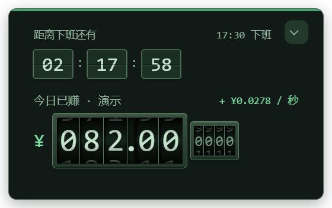

<div align="center">


# 上班鼓励器

Windows 桌面小组件 · 实时收入 · 下班倒计时 · 心愿进度 · 离线语音鼓励


[**下载 Windows 单文件版**](https://github.com/zgzzmnbx/shangban-guli/releases/latest) · [主题预览](#主题预览) · [开始使用](#开始使用) · [本地开发](#本地开发) · [反馈问题](https://github.com/zgzzmnbx/shangban-guli/issues)


v0.7.3 紧凑模式实拍，金额为演示数据。

</div>

## 功能

- **收入可视化**：按月收入、计薪天数和上下班时间估算今日收入与本月累计，金额用机械滚轮连续显示，也可切回原版数字。
- **翻页倒计时**：时、分、秒分别翻动；支持午休、选定工作日与下班状态，非计薪时段停止增长。
- **五套主题**：老钱风、金贵风、高雅、可爱、命令行，滚轮、字体和配色随主题变化。
- **心愿清单**：55 条内置心愿、14 类实物插图，支持自定义心愿、目标预算和收入等值进度。
- **金额达标鼓励**：内置 12 段预录语音，跨过金额门槛时播放对应鼓励，同日同档只播一次；启动和唤醒不补播。
- **桌面常驻**：无边框、置顶、拖动、托盘、位置记忆；紧凑窗口为 320 × 200 逻辑像素，可调不透明度、减弱动效和会议静音。

## 主题预览

以下为 v0.7.3 真实窗口截图，均使用隔离测试的演示金额。高雅主题见首页预览。

<table>
  <tr>
    <th>老钱风</th>
    <th>金贵风</th>
  </tr>
  <tr>
    <td></td>
    <td></td>
  </tr>
  <tr>
    <th>可爱</th>
    <th>命令行</th>
  </tr>
  <tr>
    <td></td>
    <td></td>
  </tr>
</table>

<details>
<summary>展开查看完整视图</summary>

完整视图提供收入估算、鼓励语、心愿进度与主题切换。下图为 v0.7.0 实拍，金额为演示数据；v0.7.3 延续该布局，并统一采用至少三位整数的金额格式。


</details>

## 开始使用

1. 在 [Releases](https://github.com/zgzzmnbx/shangban-guli/releases/latest) 下载 `WorkCheer-v0.7.3-win-x64.exe`。
2. 双击运行，首次展开运行资源需要数秒。无需安装、管理员权限或额外的 DLL 文件夹。
3. 点击设置，填写自己的收入、计薪天数、工作日和上下班／午休时间，再选择喜欢的心愿。
4. 在完整视图底部切换主题，用右上角箭头收起或展开。紧凑模式可拖动上方时间说明区。

默认月收入 **18,000 元仅为示例**，首次使用请修改。升级时先保存设置并退出旧版，再打开新版 EXE。

### 语音怎么触发

今日收入跨过 **10、50、100、200、500、1,000、2,000、5,000、10,000 元**时，播放对应档位的鼓励。另有试听、心愿进度 80% 和心愿达成音频。

日常播报使用随程序附带的本地文件，**不需要 API Key，也不会自动调用模型**。设置中可以逐档试听；如需更换音色或新增金额门槛，可自行配置百炼 API Key，明确点击在线生成或补录，生成结果会缓存供后续离线使用。在线生成按所用账户规则计费。

### 数据保存在哪里

工资、主题、心愿、窗口位置等设置保存在：

```text
%APPDATA%\WorkCheerWidget\
```

升级继续读取此目录；仅复制 EXE 不会带走个人设置。程序每次启动使用独立临时目录展开资源，正常退出后清理。可选的 API Key 使用 Electron `safeStorage` 在本机加密保存，不随源码和安装包分发。

## 本地开发

需要 **Windows x64、Node.js 22.12+ 和 npm**。应用采用 Electron 与原生 HTML / CSS / JavaScript，运行时不需要 Python、前端框架或服务器。

```powershell
git clone https://github.com/zgzzmnbx/shangban-guli.git
cd shangban-guli/03-Src
npm ci
npm run setup
npm test
npm start
```

`npm run setup` 安装项目固定版本的 Electron 运行时。打包命令：

```powershell
# Windows x64 绿色单文件 EXE
npm run build

# 文件夹形式的便携版
npm run build:folder
```

构建产物位于项目根目录的 `04-output/`；单文件构建遇到同版已有产物时停止，避免覆盖。完整实现、配置与测试隔离方法见 [开发说明](03-Src/README.md)。

```text
shangban-guli/
├── 03-Src/
│   ├── main.cjs             # 窗口、托盘、配置与语音调度
│   ├── preload.cjs          # 隔离的界面桥接
│   ├── lib/                 # 计薪、配置、语音与缓存
│   ├── ui/                  # 五主题界面与数字动效
│   ├── assets/              # 图标与预录语音
│   ├── data/                # 鼓励文案与心愿预设
│   ├── tests/               # 逻辑、配置与语音测试
│   └── tools/               # 打包工具
├── docs/images/             # README 实拍截图
└── CHANGELOG.md             # 最近版本变化
```

## 版本与验证

当前应用版本为 **v0.7.3**。本版将紧凑窗口收窄为 320 × 200，金额整数至少三位，并修复分数 DPI 下反复收放累积位移的问题。完整记录见 [CHANGELOG](CHANGELOG.md)。

现有 v0.7.3 验收记录包括 22 项逻辑／配置／语音测试、31 项打包界面检查、23 项最终单文件运行检查，以及 42 个包内资源一致性检查。测试使用独立配置，截图中的数字不代表个人收入。

当前验证范围为本机 Windows 环境，其他电脑、多显示器和长时间运行仍待验证。当前便携构建未签名，不含自动更新；macOS、Linux 尚未提供构建和验证。

## 使用边界

- 收入与心愿进度是按配置计算的**收入等值**，不代表银行到账或实际储蓄。月度估算按选定工作日计算，不自动识别法定节假日或调休。
- 心愿价格属于可修改的目标预算；联网参考估价为粗略提示，需自行核实后采纳。
- 本项目在朋友提供的桌面鼓励器基础上独立使用 Electron 实现。收到的原材料为 PyInstaller 分发包，尚无原始 Python 源码，因此不声称逐行等价；原始分发包不随本仓库上传。

欢迎通过 [Issues](https://github.com/zgzzmnbx/shangban-guli/issues) 反馈使用问题，附上应用版本、Windows 版本、缩放比例及复现步骤，便于定位。
